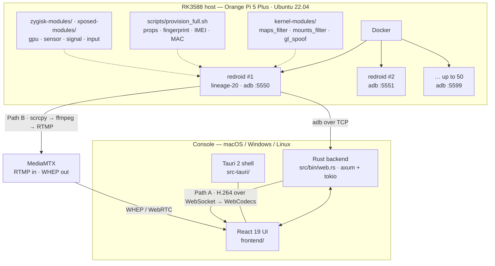

# RK3588 Android Cloud Phone Stack

**English** · [简体中文](README.zh-CN.md)

A self-hosted stack that turns one RK3588 board into a rack of virtual Android phones —
screens you can watch, and devices you can drive, from a browser tab or a desktop app.

It is not a wrapper around the `scrcpy` binary. The scrcpy v3 wire protocol is implemented
in Rust (`src/scrcpy.rs`), so the console can fan one control event out to N devices in
parallel instead of spawning N processes.

> Status: research / internal tooling. No authentication, JSON file storage, Chinese-only UI.
> Read [Status](#status) before you point this at anything you care about.

---

## What it looks like

Two containers on the same board, each provisioned as a different handset:

<p>
  
  
</p>

---

## What it does

- Runs many `redroid` containers on a single RK3588 host, one adb port each (`5550`–`5599`)
- Talks the **scrcpy v3 protocol directly** — push `scrcpy-server.jar`, open video + control
  sockets, parse H.264 PTS flags, serialize 12 control message types
- Streams each screen to the browser two ways: **H.264 over WebSocket → WebCodecs**, or
  **RTMP → MediaMTX → WHEP/WebRTC**
- Fans a single gesture out to every selected device using scoped threads
- Manages the host itself over SSH: create / start / stop / restart / batch / rotate containers
- Records an action sequence and replays it across devices
- Ships as a Tauri 2 desktop app or a plain browser console

Rough size: ~7.9k lines of Rust, ~8.5k lines of frontend, 36 Rust unit tests.

---

## Architecture



---

## The five layers

| Layer | What it is | Where |
|---|---|---|
| **L0 · Host & kernel** | The board itself plus custom kernel modules that filter `/proc/maps` and mounts and spoof the GL stack | `kernel-modules/` |
| **L1 · Containers** | `redroid` (`cnflysky/redroid-rk3588:lineage-20`), one container per virtual phone, adb exposed on `5550`–`5599` | `src/host.rs`, `scripts/` |
| **L2 · Identity** | Per-container device profile: props rewritten across 7 partitions, 8 fingerprint keys, IMEI/SERIAL/MAC, battery and first-boot age, contact and SMS history | `scripts/provision_full.sh`, `zygisk-modules/`, `xposed-modules/` |
| **L3 · Capture & control** | scrcpy v3 protocol in pure Rust; adb discovery, batching, install, logcat | `src/scrcpy.rs`, `src/adb.rs` |
| **L4 · Transport** | WebSocket + WebCodecs, and RTMP → MediaMTX → WHEP | `src/bin/web.rs`, `scripts/scrcpy-whep-bridge.sh` |
| **L5 · Console** | React 19 + Vite UI, Tauri 2 desktop shell | `frontend/`, `src-tauri/` |

---

## Two streaming paths

|  | **A · WebSocket + WebCodecs** | **B · MediaMTX + WHEP** |
|---|---|---|
| Chain | `scrcpy.rs` → WS binary → `VideoDecoder` → canvas | `scrcpy` → ffmpeg → RTMP → MediaMTX → WebRTC |
| Code | `frontend/src/hooks/useScrcpy.js` | `WhepPreview.jsx`, `scripts/scrcpy-whep-bridge.sh` |
| Extra deps | none | `ffmpeg`, `tmux`, MediaMTX |
| Viewers | 1 | many |
| Latency | ~1 frame | + jitter buffer |
| Maturity | experimental — hard-codes `avc1.42001f`, `timestamp: 0` | the path in daily use |

Path B uses the RK3588 hardware encoder (`c2.rk.avc.encoder`), so it costs the CPU almost nothing.

---

## Repository layout

```
src/
  scrcpy.rs           767  scrcpy v3 protocol: server push, sockets, PTS parsing, fan-out
  adb.rs             1490  device discovery, connect, batch shell, APK install, logcat
  host.rs             556  SSH into the RK3588 host, docker container lifecycle
  host_monitor.rs     169  CPU / memory sampling per host
  preview.rs          343  MJPEG preview stream
  storage.rs          467  JSON-file persistence
  auto_connector.rs   273  auto-connect discovered devices
  bezier.rs           126  gesture interpolation
  bin/web.rs         3430  axum HTTP + WebSocket API (~60 routes)
frontend/                   React 19 console: device grid, player, tasks, hosts
src-tauri/                  Tauri 2 desktop shell (bundles the backend as a sidecar)
kernel-modules/             maps_filter.c · mounts_filter_v4.c · gl_spoof.c
zygisk-modules/             anti-fingerprint
xposed-modules/             gpu-spoof · input-hide · sensor-noise · signal-spoof
scripts/                    provision_full.sh · scrcpy-whep-bridge.sh · rom-build/
docs/                       design notes, protocol integration plan, detection checklists
data/                       sample screenshots from a working farm
```

---

## Quick start

### Prerequisites

- An RK3588 board (Orange Pi 5 Plus is what this was built on) with Docker and `adb`
- The `cnflysky/redroid-rk3588:lineage-20` image pulled on that board
- `scrcpy-server` **v3.3.4** jar (the version is pinned in `src/scrcpy.rs`)
- Rust **1.85+** (the crate uses edition 2024)
- Node **20+**
- For path B only: `ffmpeg`, `tmux`, and a running [MediaMTX](https://github.com/bluenviron/mediamtx)

### Backend

```bash
cargo run --bin web
# binds 127.0.0.1:8876 — override with GROUP_CONTROL_HOST / GROUP_CONTROL_PORT
```

### Frontend

```bash
cd frontend
npm install
npm run dev          # http://localhost:5173, proxies /api to :8876
```

### Desktop

```bash
cd frontend
npm run tauri:dev
```

### Then

Open the console → **Settings** → add a host (IP, SSH user, password) → the backend SSHes in,
runs `adb connect` across the port range, and the device grid fills up. Pick a device and
either tap the canvas (path A) or point it at a WHEP URL (path B).

---

## API surface

The backend exposes ~60 routes under `/api`. The interesting ones:

| Route | Purpose |
|---|---|
| `GET /api/devices` | all known devices and their state |
| `GET /api/scrcpy/{serial}` | WebSocket: video frames down, control events up |
| `GET /api/preview-stream/{serial}` | MJPEG preview |
| `GET /api/hosts` · `POST /api/hosts` | managed RK3588 hosts |
| `POST /api/hosts/{id}/vms/{name}/start` | start a container |
| `POST /api/hosts/{id}/vms/batch` | act on many containers at once |
| `POST /api/hosts/{id}/rotate` | rotate containers |
| `POST /api/tasks/{id}/run` | replay a saved action template |
| `GET /api/recordings` | recorded gesture sequences |

---

## Status

Honest list of what is missing:

- **No authentication.** The server binds to `127.0.0.1` by default. Nothing in `src/bin/web.rs`
  checks a token. Do not expose it to a network you do not control without putting an
  authenticating proxy in front of it.
- **No database.** State lives in JSON files (`src/storage.rs`). Concurrent writers will corrupt it.
- **UI is Chinese only.** No i18n layer.
- **Path A is experimental.** The codec string and timestamps are hard-coded; expect artifacts.
- **No iOS.** Android only.
- **Build is not packaged.** There is no Dockerfile and no release pipeline; you build from source.

---

## A note on the fingerprint layer

`provision_full.sh`, `kernel-modules/`, `zygisk-modules/` and `xposed-modules/` exist to make a
container look like a distinct physical handset — rewritten props across every partition, spoofed
fingerprints, IMEI/MAC pairs, a plausible battery and boot history, and hooks that reshape what the
GPU, input subsystem, sensors and radio report to apps.

This is published because it is the part that is hard to re-derive, and because the whole point of
this repository is to show the *complete* chain from a board to a controllable phone.

It is research and interoperability material. If you use it to mass-create accounts, inflate
engagement, or dodge a platform's fraud systems, that is on you: it almost certainly breaks those
platforms' terms, and in some jurisdictions it is not merely a terms violation. Nothing here comes
with a warranty.

---

## License

[MIT](LICENSE)
