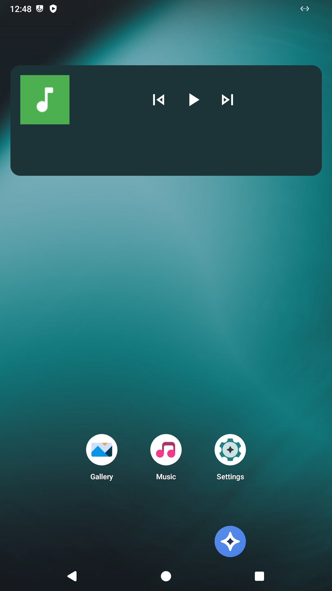
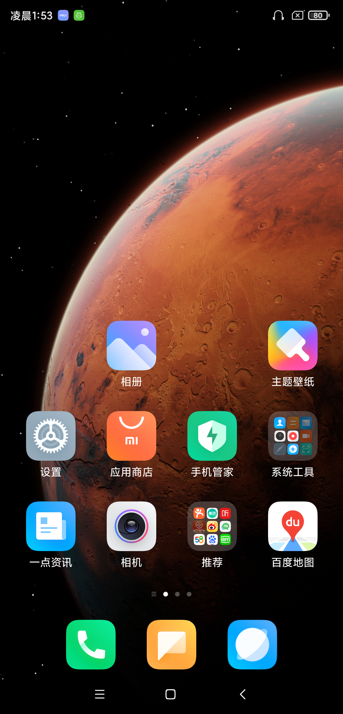
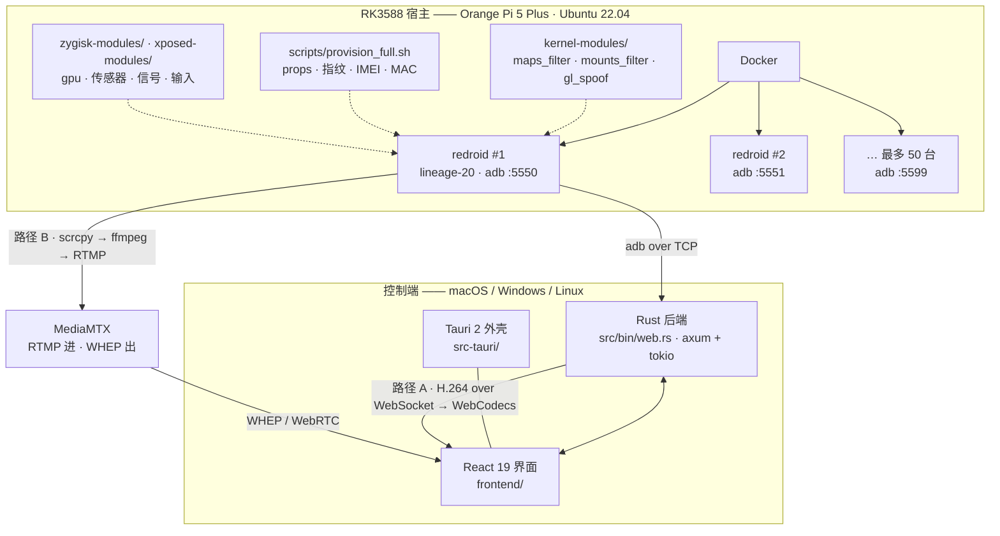

# RK3588 安卓云手机链路

[English](README.md) · **简体中文**

把一块 RK3588 板子变成一排虚拟安卓手机 —— 在浏览器标签页或桌面应用里看屏幕、直接操作。

这不是 `scrcpy` 命令行的壳。scrcpy v3 协议在 Rust 里重新实现了（`src/scrcpy.rs`），
所以一个手势可以并行下发给 N 台设备，而不是起 N 个进程。

> 状态：研究性质 / 内部工具。没有鉴权，JSON 文件存储，界面只有中文。
> 拿它接任何你在意的东西之前，先看 [现状](#现状)。

---

## 长什么样

同一块板子上的两个容器，各自被伪装成不同的手机：

<p>
  
  
</p>

---

## 它做什么

- 一块 RK3588 宿主上跑一堆 `redroid` 容器，一台虚拟手机一个 adb 端口（`5550`–`5599`）
- **直接说 scrcpy v3 协议**：推 `scrcpy-server.jar`、开视频 + 控制两个 socket、
  解析 H.264 的 PTS 标志位、序列化 12 种控制消息
- 屏幕两条路上浏览器：**H.264 over WebSocket → WebCodecs**，或 **RTMP → MediaMTX → WHEP/WebRTC**
- 一个手势用 scoped threads 并行广播到所有选中设备
- 通过 SSH 管宿主自己：容器创建 / 启动 / 停止 / 重启 / 批量 / 轮转
- 录一段操作序列，之后在多台设备上重放
- 既能打成 Tauri 2 桌面应用，也能跑纯浏览器控制台

大致体量：Rust 约 7.9k 行，前端约 8.5k 行，36 个 Rust 单元测试。

---

## 整体链路



---

## 五层拆解

| 层 | 是什么 | 在哪 |
|---|---|---|
| **L0 · 宿主与内核** | 板子本身，加上过滤 `/proc/maps`、挂载和伪造 GL 栈的内核模块 | `kernel-modules/` |
| **L1 · 容器** | `redroid`（`cnflysky/redroid-rk3588:lineage-20`），一容器一台虚拟手机，adb 映射到 `5550`–`5599` | `src/host.rs`、`scripts/` |
| **L2 · 设备身份** | 每容器的画像：7 个分区重写 props、8 个指纹键、IMEI/SERIAL/MAC、电池与开机天数、通讯录和短信历史 | `scripts/provision_full.sh`、`zygisk-modules/`、`xposed-modules/` |
| **L3 · 采集与控制** | 纯 Rust 的 scrcpy v3 协议；adb 发现、批量执行、安装、logcat | `src/scrcpy.rs`、`src/adb.rs` |
| **L4 · 传输** | WebSocket + WebCodecs，以及 RTMP → MediaMTX → WHEP | `src/bin/web.rs`、`scripts/scrcpy-whep-bridge.sh` |
| **L5 · 控制台** | React 19 + Vite 界面，Tauri 2 桌面外壳 | `frontend/`、`src-tauri/` |

---

## 两条视频链路

|  | **A · WebSocket + WebCodecs** | **B · MediaMTX + WHEP** |
|---|---|---|
| 链路 | `scrcpy.rs` → WS 二进制 → `VideoDecoder` → canvas | `scrcpy` → ffmpeg → RTMP → MediaMTX → WebRTC |
| 代码 | `frontend/src/hooks/useScrcpy.js` | `WhepPreview.jsx`、`scripts/scrcpy-whep-bridge.sh` |
| 额外依赖 | 无 | `ffmpeg`、`tmux`、MediaMTX |
| 观看人数 | 1 | 多 |
| 延迟 | 约 1 帧 | 多一个 jitter buffer |
| 成熟度 | 实验性 —— 写死 `avc1.42001f` 和 `timestamp: 0` | 实际在用的那条 |

路径 B 走 RK3588 的硬件编码器（`c2.rk.avc.encoder`），CPU 几乎不占。

---

## 目录导览

```
src/
  scrcpy.rs           767  scrcpy v3 协议：推服务端、双 socket、PTS 解析、并行广播
  adb.rs             1490  设备发现、连接、批量 shell、APK 安装、logcat
  host.rs             556  SSH 进 RK3588 宿主，docker 容器生命周期
  host_monitor.rs     169  每台宿主的 CPU / 内存采样
  preview.rs          343  MJPEG 预览流
  storage.rs          467  JSON 文件持久化
  auto_connector.rs   273  自动连接发现的设备
  bezier.rs           126  手势插值
  bin/web.rs         3430  axum HTTP + WebSocket 接口（约 60 条路由）
frontend/                   React 19 控制台：设备网格、播放器、任务、宿主
src-tauri/                  Tauri 2 桌面外壳（后端打成 sidecar 一起分发）
kernel-modules/             maps_filter.c · mounts_filter_v4.c · gl_spoof.c
zygisk-modules/             anti-fingerprint
xposed-modules/             gpu-spoof · input-hide · sensor-noise · signal-spoof
scripts/                    provision_full.sh · scrcpy-whep-bridge.sh · rom-build/
docs/                       设计稿、协议接入方案、检测项清单
data/                       从实际环境里截下来的样例截图
```

---

## 跑起来

### 需要

- 一块 RK3588 板子（本项目的开发机是 Orange Pi 5 Plus），装好 Docker 和 `adb`
- 板上拉好 `cnflysky/redroid-rk3588:lineage-20` 镜像
- `scrcpy-server` **v3.3.4** 的 jar（版本写死在 `src/scrcpy.rs` 里）
- Rust **1.85+**（crate 用了 edition 2024）
- Node **20+**
- 只有路径 B 需要：`ffmpeg`、`tmux`，以及跑起来的 [MediaMTX](https://github.com/bluenviron/mediamtx)

### 后端

```bash
cargo run --bin web
# 默认绑 127.0.0.1:8876，可用 GROUP_CONTROL_HOST / GROUP_CONTROL_PORT 改
```

### 前端

```bash
cd frontend
npm install
npm run dev          # http://localhost:5173，/api 代理到 :8876
```

### 桌面版

```bash
cd frontend
npm run tauri:dev
```

### 然后

打开控制台 → **设置** → 添加宿主（IP、SSH 用户、密码）→ 后端 SSH 进去，在端口段上
逐台 `adb connect`，设备网格就填满了。选一台设备，要么点画布（路径 A），要么给它配
一个 WHEP 地址（路径 B）。

---

## 接口一览

后端在 `/api` 下挂了约 60 条路由，常用的这些：

| 路由 | 作用 |
|---|---|
| `GET /api/devices` | 所有已知设备及其状态 |
| `GET /api/scrcpy/{serial}` | WebSocket：下行视频帧，上行控制事件 |
| `GET /api/preview-stream/{serial}` | MJPEG 预览 |
| `GET /api/hosts` · `POST /api/hosts` | 受管 RK3588 宿主 |
| `POST /api/hosts/{id}/vms/{name}/start` | 启动容器 |
| `POST /api/hosts/{id}/vms/batch` | 批量操作容器 |
| `POST /api/hosts/{id}/rotate` | 轮转容器 |
| `POST /api/tasks/{id}/run` | 重放保存的动作模板 |
| `GET /api/recordings` | 录制的手势序列 |

---

## 现状

缺什么，直说：

- **没有鉴权。** 服务默认只绑 `127.0.0.1`，`src/bin/web.rs` 里没有任何一处校验令牌。
  不要把端口暴露到你不控制的网络；非要暴露，前面套一层带认证的反向代理。
- **没有数据库。** 状态存在 JSON 文件里（`src/storage.rs`），并发写会坏。
- **界面只有中文。** 没有 i18n 层。
- **路径 A 是实验性的。** 编码字符串和时间戳是写死的，会花屏。
- **没有 iOS。** 只做安卓。
- **没有打包。** 没有 Dockerfile，没有发布流水线，只能从源码构建。

---

## 关于「设备身份」这一层

`provision_full.sh`、`kernel-modules/`、`zygisk-modules/`、`xposed-modules/` 的作用，
是让一个容器看起来像一台独立的真机 —— 每个分区重写 props、伪造指纹、配对的 IMEI/MAC、
像样的电池和开机历史，再加上 Hook 改写 GPU、输入子系统、传感器和射频向上报的东西。

公开它，是因为这是最难凭空重新推导出来的一层，也是因为本仓库的意义就在于把
「从一块板子到一台能操控的手机」这条链路完整摊开。

它属于研究 / 互操作性质的资料。拿它批量造号、刷量、绕过平台风控 —— 后果自负：
那基本一定违反平台条款，在某些司法辖区也不只是违条款而已。这里的东西不提供任何担保。

---

## 许可证

[MIT](LICENSE)
